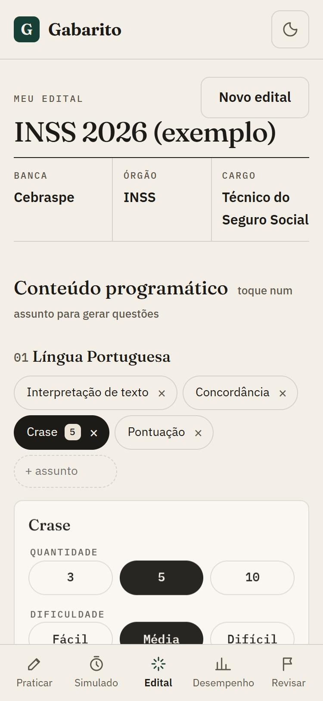
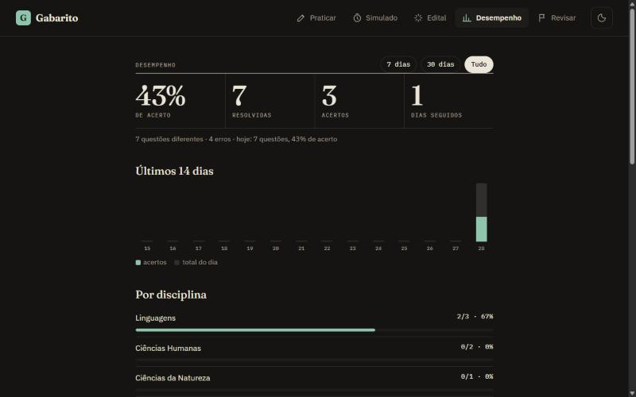
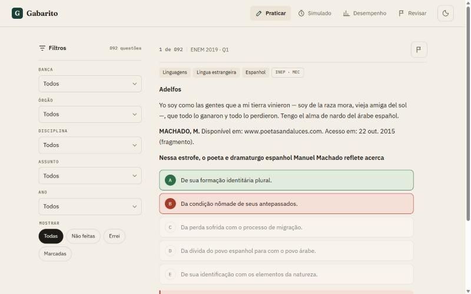
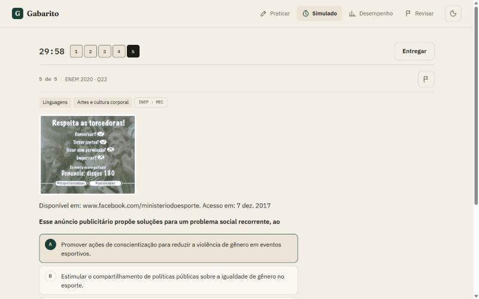
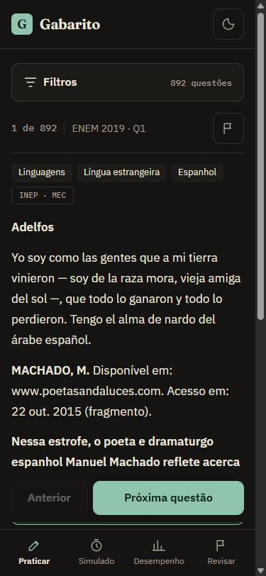
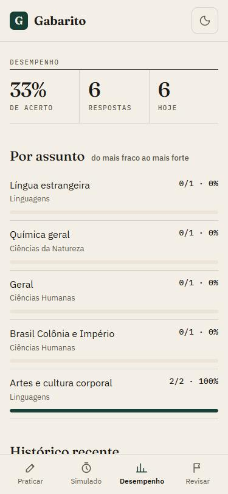
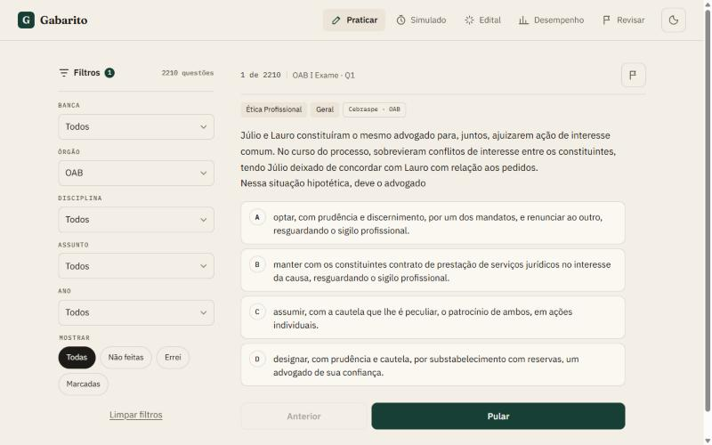

# Gabarito — questões para estudar

App web para estudar para concursos: questões oficiais com filtros, simulado cronometrado, **questões geradas por IA a partir do seu edital (por texto ou voz)** e um painel de desempenho completo. Mobile-first, modo claro e escuro; o progresso fica salvo no navegador.

| Meu edital (celular) | Painel de desempenho (desktop, escuro) |
| --- | --- |
|  |  |

| Praticar (desktop) | Simulado (desktop) |
| --- | --- |
|  |  |

| Celular, modo escuro | Desempenho no celular |
| --- | --- |
|  |  |

## Funcionalidades

- **Filtros** por banca, órgão, disciplina, assunto e ano, além de “não feitas”, “errei” e “marcadas”.
- **Resposta com feedback** imediato: alternativa certa em verde, a sua em vermelho quando erra, e o gabarito oficial. O campo `comentario` do banco aparece como gabarito comentado quando existir.
- **Simulado cronometrado**: 5 a 45 questões sorteadas, 10 a 90 minutos, mapa de navegação, entrega automática quando o tempo acaba e correção questão por questão.
- **Meu edital com IA**: cole o conteúdo programático ou fale o que vai prestar (ditado por voz no Chrome/Edge). A IA identifica banca, órgão e cargo, separa disciplinas e assuntos, e cria questões inéditas no estilo da banca (A a E ou certo/errado, três níveis de dificuldade), cada uma com gabarito comentado. Dá para editar os assuntos, ter vários editais e praticar só as questões de um edital ou assunto.
- **Bloco de estudos do edital**: junta, para cada disciplina do seu edital, as questões dos bancos abertos que tratam dela (ex.: Língua Portuguesa usa as questões de interpretação e gramática do ENEM; Direito Constitucional usa as da OAB) e as geradas pela IA. As da mesma banca do edital vêm primeiro e as disciplinas são intercaladas. Disciplinas sem questão aberta aparecem com o aviso para gerar com IA.
- **Painel de desempenho**: acerto geral, resolvidas, acertos, dias seguidos de estudo, gráfico dos últimos 14 dias, acerto por disciplina e por assunto (do mais fraco ao mais forte), filtro de 7 dias, 30 dias ou tudo, e histórico recente. Tudo em `localStorage`.
- **Marcar para revisar** com a bandeira de cada questão e refazer só as marcadas.
- **Modo escuro** automático (segue o sistema) com botão para alternar.

## Stack

Vite + React 18 + TypeScript, CSS puro com tokens. Nenhuma dependência de UI. O build final tem cerca de 50 KB de JS gzip, mais o banco de questões (~1,2 MB, cacheado).

> Usa Vite 2 para rodar também em Node 14. A Netlify faz o build em Node 20 (definido no `netlify.toml`).

## IA (Netlify Function + Claude)

A rota `/api/ia` é a função [`netlify/functions/ia.mts`](netlify/functions/ia.mts). Ela chama a API do Claude (`claude-opus-5-5`) com saída em JSON estruturado, então a resposta sempre vem no formato que o app espera. A chave fica só no servidor, nunca no navegador.

Para ligar em produção, na Netlify vá em **Site configuration → Environment variables** e crie `ANTHROPIC_API_KEY` com uma chave do [Console da Anthropic](https://console.anthropic.com). Sem a chave, o app funciona normalmente e a aba Edital mostra um aviso.

- O ditado usa a Web Speech API do navegador (sem custo e sem enviar áudio para o servidor); o texto transcrito é o que vai para a IA.
- Em `npm run dev`, a rota `/api/ia` responde com dados de exemplo (plugin em `vite.config.ts`), para testar a interface sem chave. Para testar a IA de verdade localmente: `netlify dev` com a variável definida (precisa de Node 18+).
- Para vender: cada geração custa centavos de API. Antes de abrir ao público, vale colocar login e limite de uso por pessoa (ex.: Netlify Identity ou Supabase) para ninguém usar sua chave sem controle.

## Rodar localmente

```bash
npm install
npm run dev
```

Para regerar o banco de questões a partir da API: `npm run bank`.

## Fontes das questões e licenças

São 3.102 questões reais de duas fontes abertas. Nenhuma vem de scraping de sites pagos (QConcursos, TEC etc.).

| Fonte | Conteúdo | Banca / órgão | Licença |
| --- | --- | --- | --- |
| [legal-nlp/oab-exams](https://github.com/legal-nlp/oab-exams), via [eduagarcia/oab_exams](https://huggingface.co/datasets/eduagarcia/oab_exams) | 2.210 questões da 1ª fase do Exame de Ordem, do I ao XXV Exame (2010 a 2018), 17 disciplinas de Direito | FGV (Cebraspe no I Exame) / OAB | MIT |
| [API enem.dev](https://enem.dev) ([código](https://github.com/yunger7/enem-api)) | 892 questões do ENEM de 2019 a 2023 | INEP / MEC | Provas oficiais públicas do INEP |



- **Scripts:** `npm run bank` gera `public/data/questoes.json` (ENEM) e `node scripts/build-oab.cjs` gera `public/data/oab.json`. O app lê os arquivos estáticos, sem chamar APIs ao rodar.
- **Disciplina da OAB:** 925 questões (provas de 2014 em diante) vieram sem rótulo no dataset. O script infere a disciplina pela posição da questão na prova (a OAB segue a mesma ordem de matérias) e desempata por palavras-chave. Testado contra as questões rotuladas, acerta 97% (418 de 429).
- **Assunto:** nenhuma das fontes informa o assunto. Ele é classificado por palavras-chave; o que não se encaixa fica como "Geral".
- **Gabarito comentado:** as provas oficiais não têm comentário publicado. As questões geradas pela IA vêm comentadas.
- **Educa PB (uso pessoal):** não há API nem banco aberto da Educa. O script `scripts/importar-educa.py` lê os PDFs de prova e gabarito (ex.: os do [Estude Grátis](https://www.estudegratis.com.br/provas?tag=educa)) e gera `public/data/privado/educa.json`, que fica **fora do Git** e só aparece no app rodando localmente. Com as 45 provas de Maturéia 2016, Taperoá 2017 e CRQ-PB 2017, saem 501 questões únicas (Português, Conhecimentos Gerais, Informática e Específicas por cargo); 86 delas trazem o texto-base da prova. Como o texto é extraído do PDF, às vezes um parágrafo fica fora de ordem. Uso: `python scripts/importar-educa.py <pasta com os PDFs>` (precisa do `pdftotext`).
- **Mais bancas:** o formato do JSON aceita qualquer prova pública. Basta incluir questões com `banca`, `orgao`, `prova`, `ano`, `disciplina`, `assunto`, `alternativas`, `gabarito` e, se houver, `comentario`.

## Deploy na Netlify

O `netlify.toml` já define build (`npm run build`), pasta `dist` e Node 20.

Pelo painel (sem CLI):
1. Entre em [app.netlify.com](https://app.netlify.com) → **Add new site** → **Import an existing project**.
2. Escolha o GitHub e o repositório `concurso-questoes`.
3. Confirme as configurações (já vêm do `netlify.toml`) e clique em **Deploy**.

Pela CLI (a `netlify` CLI não está instalada nesta máquina, então o deploy ainda não foi feito):

```bash
npm install -g netlify-cli
netlify login
netlify deploy --build --prod
```

## Publicar no GitHub

```bash
gh repo create concurso-questoes --public --source . --push
```

Ou, sem o `gh`: crie o repositório vazio `concurso-questoes` no GitHub e rode `git remote add origin https://github.com/<seu-usuario>/concurso-questoes.git` e `git push -u origin main`.
